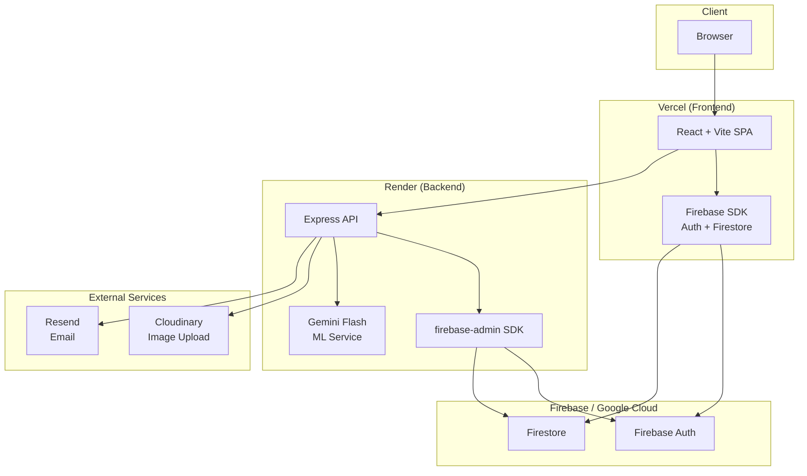
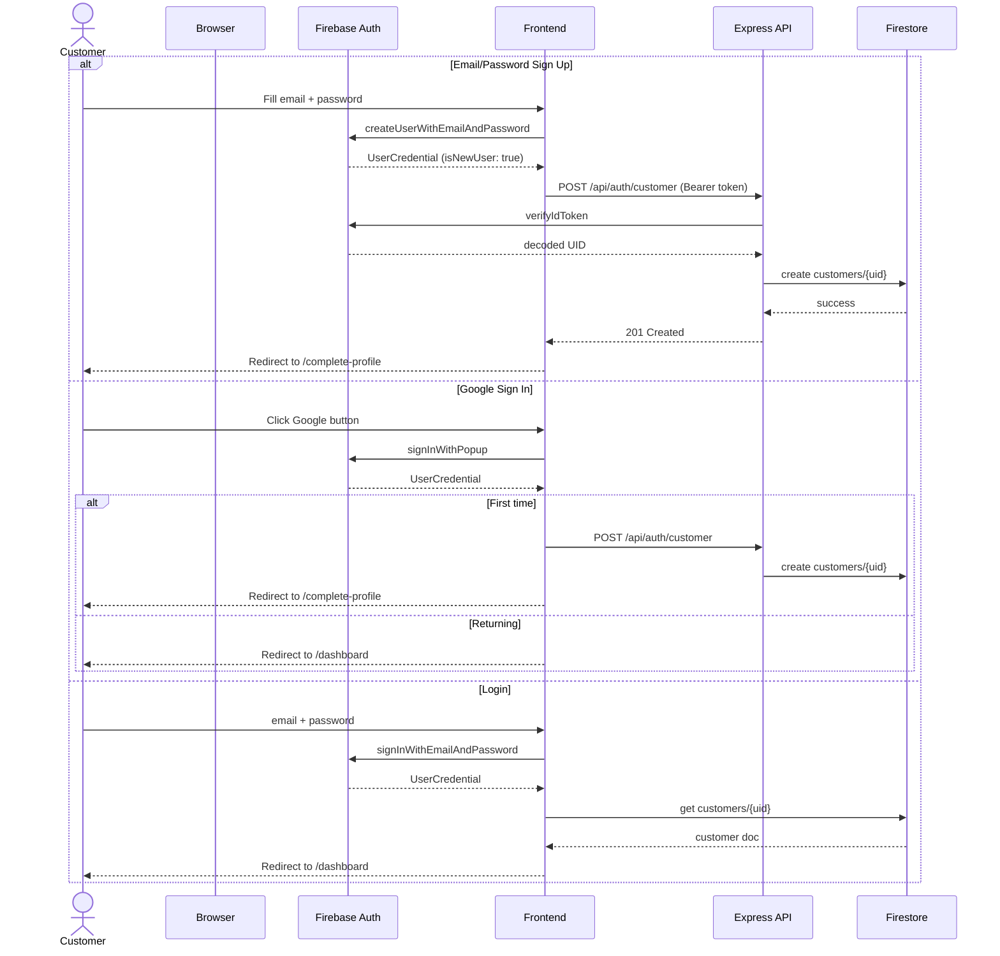
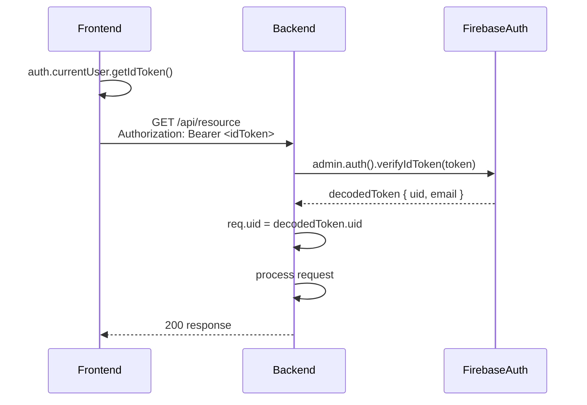
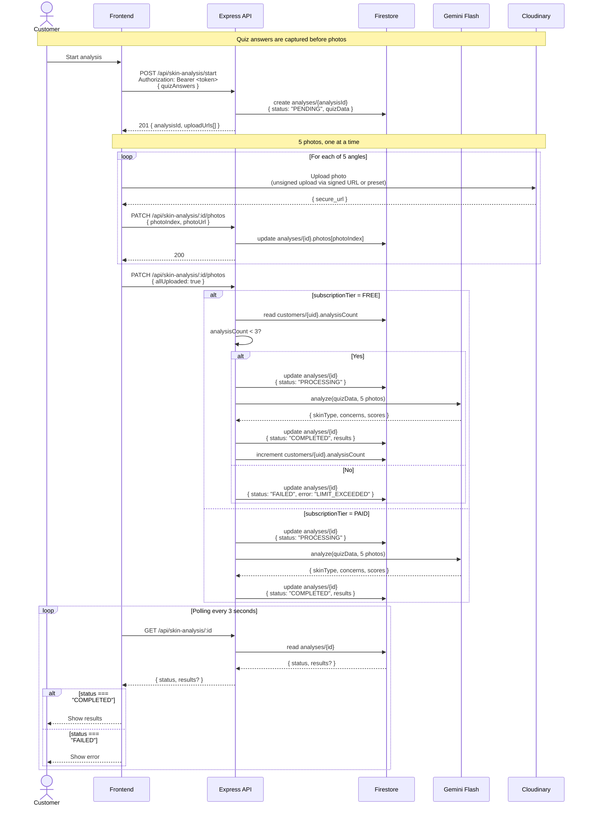
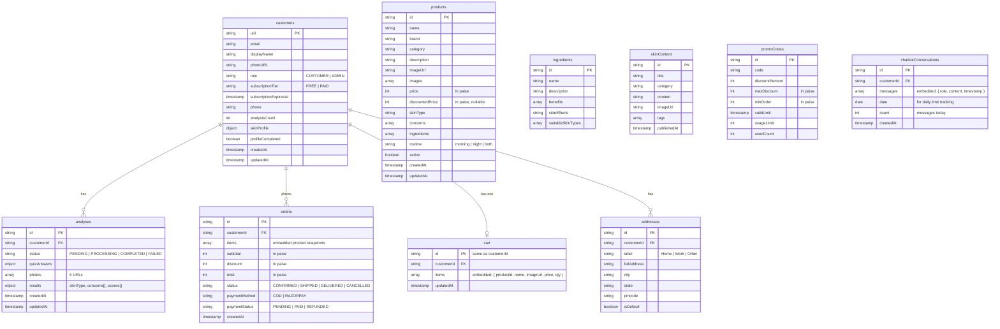
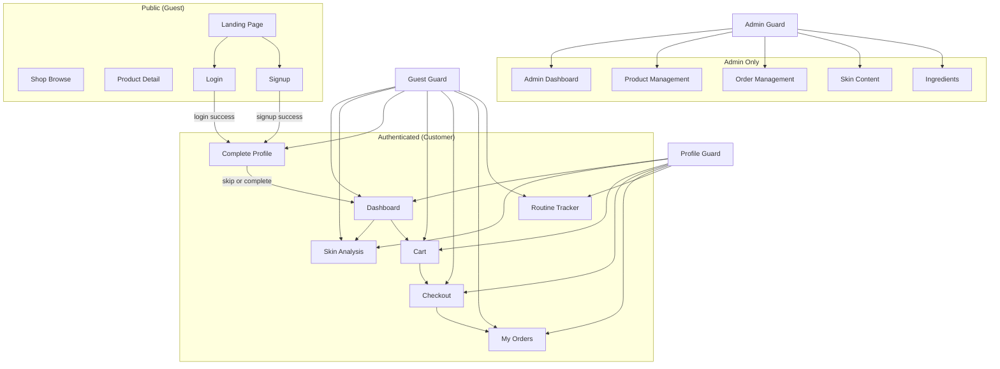

# GlowGuide — Architecture & Data Flow

**Date:** 2026-06-29  
**Stack:** Firebase Auth + Firestore, Express (Render), React + Vite (Vercel), Gemini Flash, Cloudinary (images), Resend

---

## 1. System Context



---

## 2. Authentication Flow



### Auth Token Flow (Every API Call)



---

## 3. Skin Analysis Flow (Async + Polling)



### Analysis Authorization Gate (Backend Decision Tree)

This decision tree runs inside the backend after photo upload completes but before invoking the ML model.

```
User requests skin analysis
        │
        ▼
Backend verifies Firebase token
        │
        ▼
Read customer document
        │
        ├── subscriptionTier = PAID
        │          │
        │          ▼
        │      Allow analysis
        │
        └── subscriptionTier = FREE
                   │
                   ▼
          analysisCount < 3 ?
              │          │
             Yes        No
              │          │
              ▼          ▼
      Run ML model    Return 403
      Increment
      analysisCount
```

**Details:**
- `analysisCount` is stored on the `customers/{uid}` doc and incremented after each successful analysis
- FREE tier hard limit = 3 total analyses (not per month)
- PAID tier has no limit
- On limit exceeded, the backend sets `analysis.status = "FAILED"` with error code `LIMIT_EXCEEDED`; frontend shows the upgrade nudge
- This check happens server-side only — frontend never determines access

### Firestore Analysis Document Structure

```mermaid
graph LR
    subgraph analyses
        A[analyses/{analysisId}]
    end

    A -->|customerId| C[customers/{uid}]
    A -->|status| S["PENDING | PROCESSING | COMPLETED | FAILED"]
    A -->|quizAnswers| Q[JSON object]
    A -->|photos| P["array of 5 URLs"]
    A -->|results| R["{ skinType, concerns[], confidenceScores{} }"]
    A -->|createdAt| T[Timestamp]
```

---

## 4. Shop / Order Flow

```mermaid
sequenceDiagram
    actor Customer
    participant Frontend
    participant Backend as Express API
    participant Firestore
    participant Razorpay as Razorpay (Phase 2)

    Note over Customer,Razorpay: Cart is client-managed, synced to Firestore

    Customer->>Frontend: Add item to cart
    Frontend->>Firestore: set cart/{customerId}<br/>{ items: [{ productId, qty, price }] }

    Customer->>Frontend: Proceed to checkout
    Frontend->>Backend: POST /api/orders/preview<br/>Bearer token
    Backend->>Firestore: read cart/{customerId}
    Backend->>Firestore: read products/{productId} (validate prices)
    Backend-->>Frontend: { items, subtotal, discount, total }

    Customer->>Frontend: Confirm order
    Frontend->>Backend: POST /api/orders/create<br/>Bearer token

    Note over Backend,Razorpay: Payment handled in Phase 2; Phase 1 = COD / free orders

    Backend->>Firestore: read cart/{customerId}
    Backend->>Firestore: batch write:
    Backend->>Firestore: create orders/{orderId}<br/>{ customerId, items[], subtotal, discount, total, status: "CONFIRMED", productSnapshots[] }
    Backend->>Firestore: update cart/{customerId}<br/>{ items: [], updatedAt }
    Backend-->>Frontend: 201 { orderId, status }

    Frontend->>Firestore: listen orders/{orderId} (real-time status)
    Firestream-->>Frontend: status update (CONFIRMED → SHIPPED → DELIVERED)

    Customer->>Frontend: View order in Dashboard → "My Routine"
    Frontend->>Firestore: query orders where customerId == uid<br/>order by createdAt desc
```

### Firestore Order Document Structure

```mermaid
graph LR
    subgraph orders
        O[orders/{orderId}]
    end

    O -->|customerId| C[customers/{uid}]
    O -->|items| I["[{ productId, name, qty, priceAtPurchase }]"]
    O -->|productSnapshots| PS["[{ productId, name, brand, category, imageUrl, price }]"]
    O -->|subtotal| Sub[number in paise]
    O -->|discount| D[number in paise]
    O -->|total| T[number in paise]
    O -->|status| S["CONFIRMED | SHIPPED | DELIVERED | CANCELLED"]
```

---

## 5. Firestore Data Model



---

## 6. Component Dependency & Auth Guards



---

## 7. ASCII Decision Trees (Backend Flows)

These diagrams show the pure backend decision logic for key flows — no frontend complexity, just server-side branching.

---

### 7.1 Complete Your Profile Guard

Triggered on every protected route access. If `profileCompleted === false`, the user is redirected.

```
Customer signs up (Email or Google)
              │
              ▼
     customers/{uid} created
     profileCompleted = false
              │
              ▼
     Redirect to /complete-profile
              │
              ├── Customer fills name, phone, address, skin profile
              │          │
              │          ▼
              │     PATCH /api/customers/profile
              │     customers/{uid}.profileCompleted = true
              │          │
              │          ▼
              │     Redirect to /dashboard
              │
              └── Customer clicks "Skip for now"
                         │
                         ▼
                   Redirect to /dashboard
                   (profileCompleted stays false)
                         │
                         ▼
              On next visit to any protected route:
                   ├── profileCompleted == true  →  allow
                   └── profileCompleted == false →  redirect to /complete-profile
```

---

### 7.2 Add to Cart → Checkout → Order Pipeline

```
Customer clicks "Add to Cart"
        │
        ▼
Frontend: auth.currentUser.getIdToken()
Frontend: PATCH /api/cart/add  { productId, qty }
        │
        ▼
Backend: verify Firebase token
Backend: read customers/{uid}
        │
        ├── role !== CUSTOMER  →  403
        └── role === CUSTOMER
                   │
                   ▼
            Backend: read products/{productId}
                   │
                   ├── product not found / inactive  →  404
                   ├── insufficient stock  →  400
                   └── valid product
                              │
                              ▼
                      cart/{customerId}.items.push({ productId, name, price, qty })
                      Response: 200 { items[], cartTotal }


Customer clicks "Checkout"
        │
        ▼
Frontend: POST /api/orders/preview
        │
        ▼
Backend: verify Firebase token
Backend: read cart/{customerId}
Backend: read products (all items — validate current prices)
        │
        ├── cart empty  →  400
        ├── price mismatch →  return updated prices (frontend confirms)
        └── all valid
                   │
                   ▼
            Response: { items[], subtotal, discount(0 for now), total }


Customer clicks "Place Order"
        │
        ▼
Frontend: POST /api/orders/create
        │
        ▼
Backend: verify Firebase token
Backend: read cart/{customerId} (final validation)
        │
        ├── cart empty  →  400
        └── cart has items
                   │
                   ▼
            Firestore batch write:
             1. orders/{orderId}  ←  items[] + productSnapshots[] + totals
             2. cart/{customerId} ←  items: [] (clear cart)
                   │
                   ▼
            Response: 201 { orderId, status: "CONFIRMED" }
```

---

### 7.3 Admin Route Guard

Triggered on every admin route access. Admin dashboard is on a separate route (`/admin/*`).

```
Request to /admin/*
        │
        ▼
Frontend: auth.currentUser.getIdToken()
Frontend: GET /api/admin/verify
Authorization: Bearer <token>
        │
        ▼
Backend: verify Firebase token → req.uid
Backend: read customers/{req.uid}
        │
        ├── doc not found  →  401
        ├── role !== ADMIN  →  403
        └── role === ADMIN
                   │
                   ▼
            Response: 200 { role: "ADMIN", displayName }
            Frontend renders admin dashboard
            (Admin layout is different from main site)
```

---

### 7.4 Chatbot Query Flow

Free tier: 10 queries/day. Paid tier: unlimited. Backend checks daily count against Firestore.

```
Customer sends message to chatbot
        │
        ▼
Frontend: POST /api/chatbot/ask  { message }
Authorization: Bearer <token>
        │
        ▼
Backend: verify Firebase token → req.uid
Backend: read customers/{req.uid}
        │
        ├── subscriptionTier = FREE
        │          │
        │          ▼
        │    chatbotConversations/{uid}_{YYYY-MM-DD}
        │    read today's conversation doc
        │          │
        │          ├── doc not exists → create { count: 0 }
        │          └── doc exists → read count
        │                    │
        │                    ├── count >= 10  →  Response: 403 { error: "DAILY_LIMIT_EXCEEDED" }
        │                    │                    Frontend shows upgrade nudge
        │                    │
        │                    └── count < 10
        │                              │
        │                              ▼
        │                    Call Gemini Flash with context
        │                    (products, ingredients, skin concerns)
        │                              │
        │                              ▼
        │                    chatbotConversations/{id}
        │                    .messages.push({ role: "user", content })
        │                    .messages.push({ role: "assistant", content })
        │                    .count += 1
        │                              │
        │                              ▼
        │                    Response: 200 { reply, remainingQuota: 10 - count - 1 }
        │
        └── subscriptionTier = PAID
                   │
                   ▼
            chatbotConversations/{uid}_{YYYY-MM-DD}
            create if not exists (no count check)
                   │
                   ▼
            Call Gemini Flash
                   │
                   ▼
            chatbotConversations/{id}
            .messages.push({ role: "user", content })
            .messages.push({ role: "assistant", content })
                   │
                   ▼
            Response: 200 { reply }
```

---

### 7.5 Subscription Upgrade Flow

Phase 1: Admin upgrades via Firestore console. Phase 2: Customer pays via Razorpay → backend webhook.

```
PHASE 1 — Manual (Firestore Console)
Admin opens Firestore → customers/{uid}
        │
        ▼
Admin sets:
  subscriptionTier: "PAID"
  subscriptionExpiresAt: "2027-06-29T00:00:00Z"
        │
        ▼
Next customer API call:
  Backend reads customers/{uid}
  subscriptionTier === "PAID" → all premium features unlocked


PHASE 2 — Razorpay (Future)
Customer clicks "Upgrade" → redirected to Razorpay checkout
        │
        ▼
Customer pays via Razorpay
        │
        ▼
Razorpay sends webhook to POST /api/payments/webhook
        │
        ▼
Backend: verify webhook signature
Backend: read event type
        │
        ├── event === "payment.captured"
        │          │
        │          ▼
        │    customers/{uid}
        │    subscriptionTier = "PAID"
        │    subscriptionExpiresAt = now + 1 month/year
        │
        └── event === "payment.failed"
                   │
                   ▼
            Log error, no Firestore changes
```

---

### 7.6 Photo Upload Flow (Client → Cloudinary → Backend)

```
Customer captures photo (5 angles)
        │
        ▼
Frontend: POST /api/skin-analysis/start
{ quizAnswers }
        │
        ▼
Backend: create analyses/{id} (status: "PENDING")
Backend: return { analysisId, cloudinaryPreset }
        │
        ▼
Frontend: upload image to Cloudinary
POST https://api.cloudinary.com/v1_1/<cloud>/image/upload
{ file: blob, upload_preset: <preset> }
        │
        ├── upload fails (network, size, format)
        │          │
        │          ▼
        │    Frontend shows retry UI for that angle
        │    (do not proceed until all 5 succeed)
        │
        └── upload succeeds
                   │
                   ▼
            Cloudinary returns { secure_url, public_id }
                   │
                   ▼
            Frontend: PATCH /api/skin-analysis/{id}/photos
            { index: 0-4, photoUrl: secure_url }
                   │
                   ▼
            Backend: analyses/{id}.photos[index] = secure_url
            (index validated: must be 0-4, no duplicates per index)
                   │
                   ▼
            After all 5: Frontend sends PATCH with allUploaded: true
            → triggers analysis authorization gate (diagram 3.1)
```

---

### 7.7 API Error Response Structure

All backend endpoints return a consistent error shape.

```
Backend error occurs
        │
        ▼
Response JSON shape:
{
  "error": {
    "code": "ERROR_CODE",
    "message": "Human-readable description",
    "details": {}     // optional, extra context
  }
}
        │
        ├── 400 Bad Request
        │     code: "INVALID_INPUT"
        │     code: "CART_EMPTY"
        │     code: "MISSING_FIELD"
        │
        ├── 401 Unauthorized
        │     code: "MISSING_TOKEN"
        │     code: "INVALID_TOKEN"
        │     code: "TOKEN_EXPIRED"
        │
        ├── 403 Forbidden
        │     code: "NOT_ADMIN"
        │     code: "LIMIT_EXCEEDED"
        │     code: "SUBSCRIPTION_REQUIRED"
        │
        ├── 404 Not Found
        │     code: "CUSTOMER_NOT_FOUND"
        │     code: "PRODUCT_NOT_FOUND"
        │     code: "ANALYSIS_NOT_FOUND"
        │
        └── 500 Internal Server Error
              code: "INTERNAL_ERROR"
              message: "Something went wrong"
              (details omitted in production)
```

Frontend handles errors per code:
- `LIMIT_EXCEEDED` → Show upgrade nudge modal
- `NOT_ADMIN` → Redirect to home
- `MISSING_TOKEN` / `INVALID_TOKEN` → Force logout, redirect to login
- `DAILY_LIMIT_EXCEEDED` → Show upgrade nudge on chatbot
- All `400` codes → Show inline validation message
- `INTERNAL_ERROR` → Show generic "Something went wrong" toast

---

## 8. Free Tier Budget

| Service | Free Tier Limit | Phase 1 Est. Usage | Headroom |
|---|---|---|---|
| Firebase Auth | 10K MAU | ~50 MAU (dev + testers) | 200x |
| Firestore | 50K reads/day, 20K writes/day, 1GB stored | ~500 reads, ~100 writes/day | 100x |
| Gemini Flash | 60 requests/min, 1M tokens/min | ~20 req/min (peak during analysis) | 3x |
| Cloudinary | 25GB storage, 25GB bandwidth/mo | ~1GB images | 25x |
| Vercel | 100GB bandwidth, 6000 build min/mo | Trivial | High |
| Render | 750 hours/mo (sleeps after 15 min) | Always-on not needed | OK |
| Resend | 100 emails/day | ~5 emails/day | 20x |

---

## 9. Key Design Decisions

| Decision | Rationale |
|---|---|
| Async + polling for analysis | ML model may take 5-15s; synchronous HTTP timeout would fail |
| Photos uploaded directly to Cloudinary | Offloads image processing, avoids backend storage costs |
| Cart items embedded in single doc | Simpler than subcollections; cart is always read/written as a unit |
| Product snapshots in orders | Preserves purchase history even if product catalog changes |
| Admin role in Firestore doc (not Custom Claims) | Instant role change without token refresh; simpler code |
| Analysis count stored on customer doc | Single read for limit check; avoid count queries |
| Prices in paise | Avoids floating point precision issues with rupees |
| Google sign-in from frontend SDK | Firebase handles OAuth; backend only verifies tokens |
